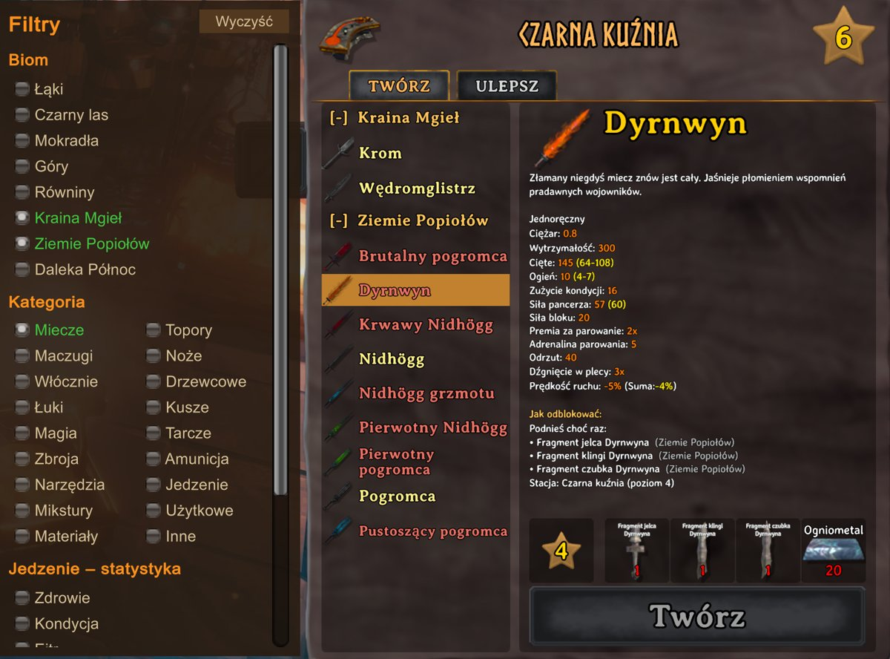
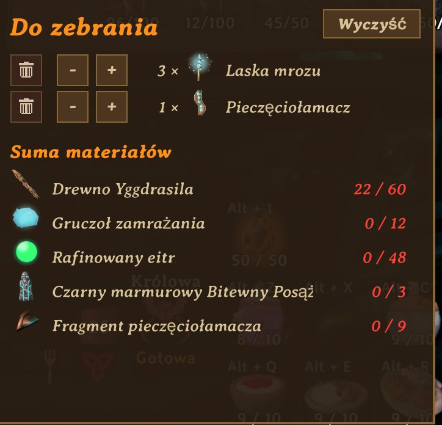
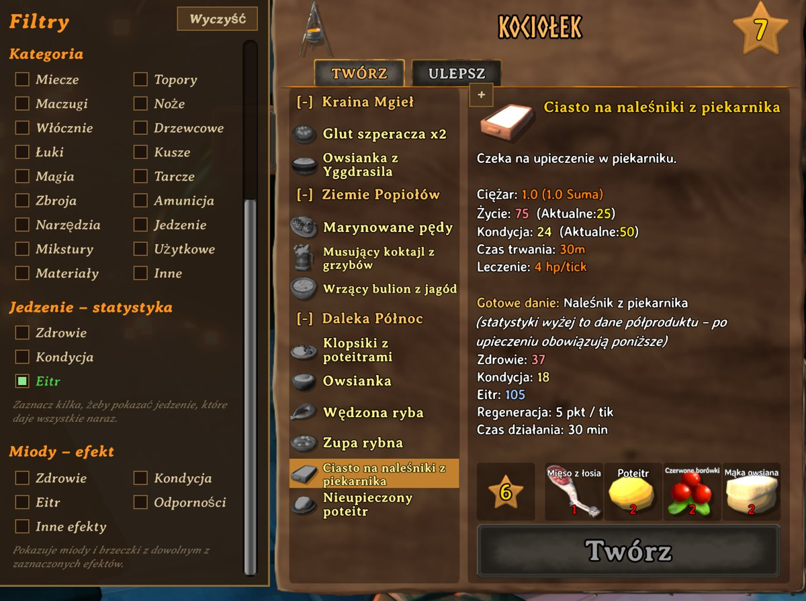

# BiomeCrafting – Valheim mod

**[⬇ Pobierz najnowszą wersję / Download latest release](https://github.com/RenAiNoUta/BiomeCrafting/releases)**

🇵🇱 [Polski](#polski) · 🇬🇧 [English](#english)

---

## Polski

Porządkuje menu craftingu w Valheim według biomów i dodaje filtry, kolory oraz listę materiałów do zebrania.

### Co robi
- **Przepisy pogrupowane biomami** (Łąki → Daleka Północ) z nagłówkami, które można zwijać.
- **Filtry**: biom, kategoria (miecze, łuki, zbroja…), jedzenie według głównej statystyki, miody według efektu – można łączyć kilka naraz.
- **Kolory stanu przepisu**: można wytworzyć / brak materiałów / za niski poziom stacji / nieodkryte (jest też tryb dla daltonistów).
- **„Jak odblokować”**: przy nieodkrytych przepisach pokazuje, których materiałów jeszcze nie podniosłeś i z jakiego biomu są; przy za słabej stacji – jakich ulepszeń brakuje.
- **Gotowe danie**: przy półproduktach i ucztach pokazuje statystyki po upieczeniu.
- **Lista materiałów do zebrania**: przycisk **+** przy przepisie, do 5 przedmiotów, suma materiałów w porównaniu z plecakiem – widoczna także przy skrzyni.

### Instalacja
1. Zainstaluj **BepInEx**: pobierz [BepInExPack_Valheim](https://valheim.thunderstore.io/package/denikson/BepInExPack_Valheim/) („Manual Download”), skopiuj zawartość folderu `BepInExPack_Valheim` do folderu gry (obok `valheim.exe`), uruchom grę raz i zamknij.
   Folder gry: Steam → prawy klik na Valheim → Zarządzaj → Przeglądaj pliki lokalne.
2. Pobierz paczkę z **[Releases](https://github.com/RenAiNoUta/BiomeCrafting/releases)** i rozpakuj ją do folderu gry – plik trafi do `BepInEx\plugins\BiomeCrafting.dll`.
3. Uruchom grę.

**Ustawienia:** `BepInEx\config\renainouta.biomecrafting.cfg` (edytuj przy wyłączonej grze), m.in. `Jezyk`, `TrybDaltonistow`, `PozycjaListy`, `UkryjNazwyNieodkrytych`.

Mod działa tylko po stronie gracza – nie trzeba go instalować na serwerze. Nie zmienia zapisów świata ani postaci. Aby odinstalować, usuń `BiomeCrafting.dll`.

### Kompilacja (dla chętnych)
- Visual Studio 2022+ z „.NET desktop development”, BepInEx zainstalowany w grze.
- Jeśli gra nie leży w domyślnym folderze Steama, skopiuj `src/Local.props.example` jako `src/Local.props` i wpisz swoją ścieżkę.
- Otwórz `src/BiomeCrafting.csproj` → **Build → Rebuild Solution**. DLL sam skopiuje się do `BepInEx\plugins` (gra musi być wyłączona).

---

## English

Sorts Valheim's crafting menu by biome and adds filters, state colors and a materials shopping list.

### Features
- **Recipes grouped by biome** (Meadows → Deep North) with collapsible headers.
- **Filters**: biome, category, food by main stat, meads by effect – combinable.
- **Recipe state colors**: craftable / missing materials / station level too low / undiscovered (colorblind mode available).
- **"How to unlock"** hints for undiscovered recipes and missing station upgrades.
- **Finished dish** stats for uncooked items and feasts.
- **Materials shopping list**: **+** button on a recipe, up to 5 items, totals compared with your inventory – also visible at chests.

### Install
1. Install [BepInExPack_Valheim](https://valheim.thunderstore.io/package/denikson/BepInExPack_Valheim/): copy the contents of the `BepInExPack_Valheim` folder into the game folder, start the game once, close it.
2. Download the archive from **[Releases](https://github.com/RenAiNoUta/BiomeCrafting/releases)** and extract it into the game folder (→ `BepInEx\plugins\BiomeCrafting.dll`).
3. Start the game.

Settings: `BepInEx\config\renainouta.biomecrafting.cfg` – set `Jezyk = EN` to force English (Auto uses English for any non-Polish game language).
Client-side only. Uninstall by deleting the DLL.

### Building
Visual Studio 2022+ (.NET desktop development) and BepInEx in the game folder. If the game isn't in Steam's default folder, copy `src/Local.props.example` to `src/Local.props` and set your path. Open `src/BiomeCrafting.csproj` → Rebuild.

---

*Valheim is a trademark of Iron Gate AB. This is an unofficial fan mod.*
